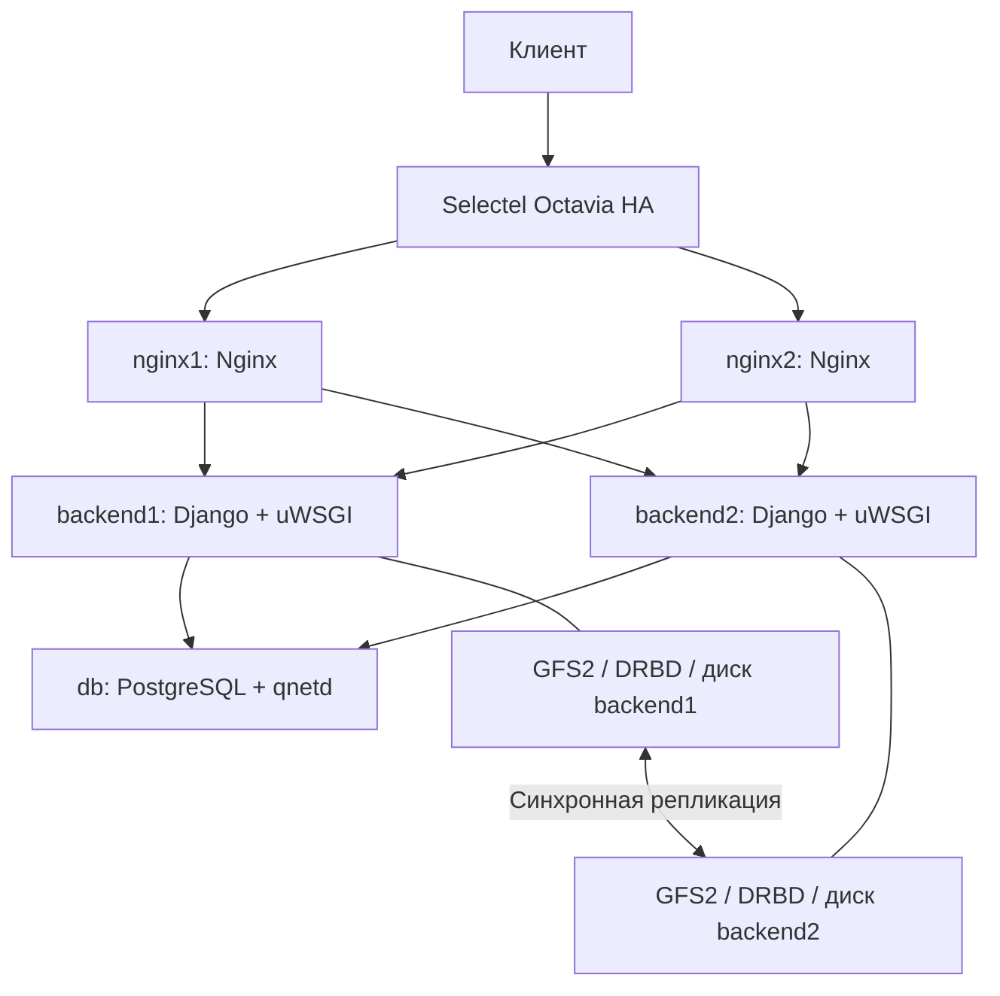

# ДЗ04. Настройка веб-приложения под высокую нагрузку

## Цель работы

Развернуть средствами Terraform и Ansible веб-приложение с балансировкой
нагрузки, общим хранилищем статики на backend и устойчивостью к отказу
одного фронта или backend. Проверить воспроизводимость развёртывания
и поведение системы при выбранных отказах.

## Реализованное решение

В проекте реализована база знаний о домашних заданиях OTUS на пяти
виртуальных машинах Selectel. Инфраструктура описана в Terraform,
конфигурации серверов — в Ansible. Приложение использует Django, uWSGI
и отдельный сервер PostgreSQL. Такое приложение связывает работу
с предыдущими ДЗ и позволяет проверить динамические страницы, доступ
к БД и обслуживание файлов из общего хранилища.

## Архитектура



| Узлы | Количество | vCPU / RAM на ВМ | Диски на ВМ |
| --- | ---: | --- | --- |
| Nginx | 2 | 1 / 1 ГБ | HDD 10 ГБ |
| Django/uWSGI | 2 | 1 / 2 ГБ | HDD 10 ГБ + 1 ГБ данных |
| PostgreSQL и qnetd | 1 | 1 / 1 ГБ | HDD 10 ГБ |

Стенд использует 5 vCPU, 7 ГБ RAM и 52 ГБ HDD. Для фронтов и БД выбрана
гарантированная доля CPU 20%, для backend — стандартные vCPU.
Стенд предназначен для учебных испытаний; его размеры не являются
рекомендацией для промышленной высокой нагрузки.

Облачный балансировщик распределяет TCP-соединения между двумя Nginx.
Каждый Nginx балансирует запросы между обоими backend по протоколу uwsgi.
GFS2 смонтирована на обоих backend в `/srv/otus`; на ней находятся
`static` и `media`. Статику отдаёт uWSGI через static-map, фронты кешируют
успешные ответы. Всего в стенде два экземпляра Nginx.

Pacemaker управляет ресурсами в порядке DRBD promoted → DLM → GFS2 → uWSGI.
Арбитр Corosync на ВМ БД участвует в кворуме и не хранит третью реплику файлов.
Агент fencing выключает проблемный backend, чтобы тот не продолжал запись
в общее хранилище. Агент разрешает выключение только двух backend-серверов,
проверяя их идентификаторы. Права сервисного пользователя Selectel
распространяются на проект целиком; ограничение проверяется внутри агента.
Успешное выключение подтверждается состояниями SHUTOFF и power_state=4.
Credentials оператора Terraform на ВМ не передаются.

## Соответствие заданию

| Требование | Реализация |
| --- | --- |
| 2 nginx, 2 backend, 1 db | Пять ВМ Terraform |
| Nginx и балансировка фронтов | Два Nginx и Selectel Octavia HA |
| uWSGI/Unicorn/PHP-FPM | Django + uWSGI, установка Ansible |
| GFS2 на backend для статики | Общий том на двух backend поверх DRBD |
| Некластеризованная СУБД | PostgreSQL на отдельной ВМ |
| Испытания отказов | Отключение обеих фронтовых и обеих backend ВМ по очереди |

Облачная инфраструктура реализована в Selectel. Для варианта Yandex Cloud
был направлен запрос на увеличение квот. С момента подачи запроса и на момент
выполнения работы предоставлено увеличение только дисковых квот;
запрошенное увеличение квот vCPU не предоставлено. Доступных квот CPU
недостаточно для развёртывания стенда, поэтому выбран Selectel.
Keepalived в этом варианте не разворачивается: роль балансировщика перед фронтами
выполняет Octavia. Каталог `terraform/` содержит отдельную конфигурацию для Yandex Cloud;
выполненный и проверенный вариант описан для Selectel.

Для управления ВМ, дисками, сетями и Octavia используется
`terraform-provider-openstack/openstack` версии 3.4.0. Этот провайдер
работает с OpenStack API Selectel. Проект и сервисные пользователи
подготавливаются отдельно, поэтому дополнительный провайдер
`selectel/selectel` не требуется. Подробности — в
[обосновании архитектуры](docs/architecture-review.md).

## Запуск

Управляющее рабочее место проверено на Windows с PowerShell и Python 3.12.
Ansible выполняется на nginx1 в отдельном Linux venv. Внешний SSH к фронтам
использует TCP/22 с ограничением по IPv4 оператора; внутренний SSH — TCP/22.
Сайт обслуживается на HTTP/80.
Полная подготовка проекта, учётных записей, ключей и параметров описана
в [инструкции Selectel](docs/selectel.md). Команды выполняются из корня репозитория.

После настройки доступа, tfvars и отдельной учётной записи fencing
развёртывание выполняется следующими командами. Они создают и настраивают
стенд, который остаётся работать до отдельной команды удаления:

```powershell
.\scripts\selectel-deploy.ps1 -CreateResources
.\.tools\venv\Scripts\python.exe scripts/verify_selectel_fencing.py --empty-storage
.\.tools\venv\Scripts\python.exe scripts/controller.py --cloud selectel run initialize.yml -e allow_experimental_storage=true -e initialize_storage=true -e fencing_verified=true
.\.tools\venv\Scripts\python.exe scripts/controller.py --cloud selectel run activate.yml
.\.tools\venv\Scripts\python.exe scripts/controller.py --cloud selectel run verify.yml
```

Проверка работоспособности уже запущенного стенда:

```powershell
.\.tools\venv\Scripts\python.exe scripts/controller.py --cloud selectel run verify.yml
```

Команды отказных испытаний приведены в [testing.md](docs/testing.md).
Проверки не удаляют инфраструктуру; отказные сценарии временно выключают
отдельные узлы и восстанавливают их.

Инициализация выполняется один раз на новых пустых дисках. При частичном сбое
следует сохранить state, проверить метаданные и продолжить с нужного этапа, без повторного
форматирования. Повторный `site.yml` сохраняет настроенный кворум и GFS2.
Для обновления кода выполняются upload, site.yml и activate.yml; уже работавшее
приложение перезапускается через Pacemaker.

Адрес сайта доступен из output `lab.site_url`:

```powershell
.\scripts\tf-selectel.ps1 output -json lab
```

В базе знаний размещены четыре начальных материала о предыдущих ДЗ.
Публичный сайт доступен для чтения; для редактирования предусмотрена Django
admin. Общего пароля администратора нет: пользователь создаётся интерактивно
через `manage.py createsuperuser`. Стенд работает по HTTP; для входа в admin
используется SSH-туннель. Публичная эксплуатация требует настройки HTTPS.

## Результаты

Проверены взаимное чтение файлов GFS2, UpToDate/UpToDate, динамика,
readiness и статика через оба фронта. Отключение каждого фронта и backend
по очереди прошло; после каждого испытания узел вернулся в рабочее состояние.
При разделении сети кластер выключил backend2 через fencing, оставшийся узел
обслуживал сайт. После восстановления обе реплики и общий том прошли проверки.

Развёртывание с пустого Terraform state и повторное применение Ansible
прошли успешно. При повторном site.yml на всех пяти ВМ:
changed=0, failed=0, unreachable=0.

Проверки и результаты приведены в [отчёте](docs/deployment-status.md)
и [результатах JSON](docs/verification-results.json).
Порядок испытаний описан в [testing.md](docs/testing.md),
состав ресурсов — в [selectel-cost.md](docs/selectel-cost.md).

## Ограничения и промышленная альтернатива

DRBD 9 dual-primary + GFS2 используется как неподдерживаемый учебный
эксперимент. Успешные испытания не отменяют ограничения производителя и
не доказывают безопасность всех вариантов отказа гостя, сети и хранилища.
PostgreSQL и базовый облачный роутер остаются отдельными точками отказа;
все ВМ находятся в одном сегменте. Репликация не заменяет резервное копирование.

Для промышленной эксплуатации рекомендуется отказоустойчивое общее блочное
хранилище с резервируемыми iSCSI-контроллерами и несколькими путями доступа.
Оба backend подключают один согласованный LUN через multipath и используют
GFS2. Возможный вариант — два выделенных storage-узла с DRBD single-primary
и переключением iSCSI target active-passive. При переключении сохраняются
данные и идентичность LUN/WWID. Такая схема требует отдельного проектирования
и не входит в эксперимент на пяти ВМ.

## Удаление

После испытаний удаляются ресурсы отдельного state:

```powershell
.\scripts\selectel-cleanup.ps1
```

Скрипт проверяет destroy-план и отсутствие управляемых ресурсов после удаления.
Остановка ВМ не прекращает оплату дисков, IP и балансировщика.
Credentials, SSH-ключи, tfvars, state, планы и сырые журналы находятся в
игнорируемых локальных каталогах. Исходники и обезличенные результаты сохраняются.

## Состав репозитория

| Каталог | Содержимое |
| --- | --- |
| [terraform-selectel/](https://github.com/airiga1897/OTUS_DZ04/tree/develop/terraform-selectel) | Основная инфраструктура Selectel |
| [terraform/](https://github.com/airiga1897/OTUS_DZ04/tree/develop/terraform) | Исходный вариант Yandex Cloud |
| [ansible/](https://github.com/airiga1897/OTUS_DZ04/tree/develop/ansible) | Роли, playbook и шаблоны конфигураций |
| [app/](https://github.com/airiga1897/OTUS_DZ04/tree/develop/app) | Django-приложение и начальные материалы |
| [scripts/](https://github.com/airiga1897/OTUS_DZ04/tree/develop/scripts) | Подготовка, запуск, проверки и удаление |
| [tests/](https://github.com/airiga1897/OTUS_DZ04/tree/develop/tests) | Unit-тесты инфраструктурных скриптов |
| [docs/](https://github.com/airiga1897/OTUS_DZ04/tree/develop/docs) | Архитектура, запуск и результаты проверок |

## Источники

- [DRBD User Guide](https://linbit.com/drbd-user-guide/drbd-guide-9_0-en/).
- [Комментарий LINBIT о поддержке dual-primary](https://forums.linbit.com/t/3rd-node-cant-join-as-secondary-with-2-primaries/899/2).
- [uWSGI static-map](https://uwsgi-docs.readthedocs.io/en/latest/StaticFiles.html).
